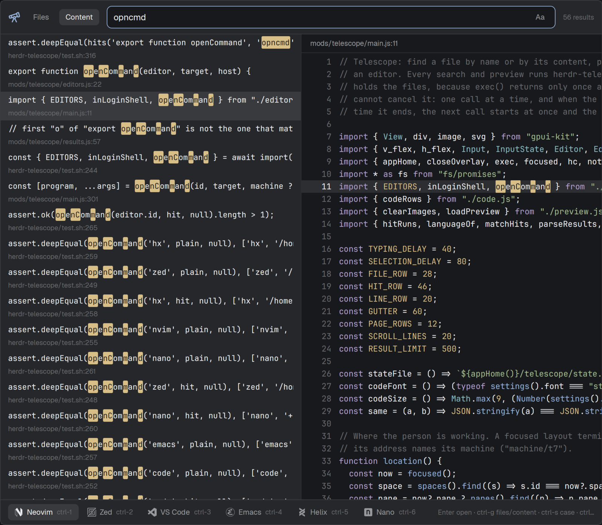

# Telescope for Herdr

A [Herdr](https://herdr.dev) app mod, inspired by
[telescope.nvim](https://github.com/nvim-telescope/telescope.nvim), that finds a
file in a few keystrokes. Type a few letters of a file's name or of something
inside it, see the file in a preview, and open it in your editor at the line
that matched.



- **Fuzzy search on names.** `perchk` finds `permission_check.rs`.
- **Fuzzy search on content.** `prmsion chk` finds "the permission check runs
  here". A repository of 3 million lines answers in under 100 ms on a warm disk
  cache.
- **Exact or regex when you need it.** One key makes each word match only as
  letters in a row, and another makes the query a regular expression.
- **Matches you can see.** The letters that matched are marked in the list, and
  in the preview of a content match, which also shows its line numbers.
- **What just changed.** One key limits both searches to the files git reports as
  changed, to read what an agent touched, or to search only inside it.
- **Where you were.** With nothing typed, the files you opened last come first.
- **A preview for most files.** Code with syntax highlighting, rendered
  Markdown, images, SVG, PDF and Office documents page by page, video frames,
  audio tags, archive listings, SQLite schemas, and a hex dump for the rest.
- **Your editor.** Neovim, Vim, Emacs, Helix, Nano and Micro open in a new pane;
  Zed and VS Code open on this computer. Choose an editor in the radio group,
  then press Enter to open. Only installed editors are offered, and your choice
  is remembered.
- **Where a file lives.** Opening a file also shows it in the side panel of the
  [filetree](https://herdr.dev/mods/cybertron288/filetree) mod, with its folders
  open. A key and a button show it without opening it.
- **Remote spaces too.** Searches and previews run on the machine that holds the
  files, so a space on another machine works like a local one.

## Requirements

- The Herdr app (tested with 0.1.13) and herdr-core (tested with 0.1.18).
- On every machine whose files you browse: bash, GNU coreutils, and
  [ripgrep](https://github.com/BurntSushi/ripgrep),
  [fzf](https://github.com/junegunn/fzf) and [jq](https://jqlang.org). It targets
  Linux; macOS would need GNU coreutils.

Previews use these tools when the machine has them. Without one, the preview
shows the file's details and names what to install.

| Files | Tool |
|---|---|
| PNG, JPEG, WebP, GIF, BMP, TIFF, AVIF, HEIC, ICO | ImageMagick 7 (`magick`) |
| SVG | librsvg (`rsvg-convert`) |
| PDF | poppler-utils (`pdftoppm`, `pdfinfo`) |
| Word, Excel, PowerPoint, OpenDocument, RTF | LibreOffice (`soffice`) and poppler-utils |
| Video | `ffmpegthumbnailer`, and `ffprobe` for its details |
| Audio | `ffprobe` |
| Archives | libarchive (`bsdtar`) |
| SQLite | `sqlite3` |
| Type of other binary files | `file` |

Install [bubblewrap](https://github.com/containers/bubblewrap) (`bwrap`) too: it
runs these tools in a sandbox, as described under
[What it runs and reads](#what-it-runs-and-reads).

To reveal a file in a tree, install
[filetree](https://herdr.dev/mods/cybertron288/filetree) and put it in a block of the
`panel-body` stack of your layout's side panel, in the `files` block or one of its
own. Herdr's own Files panel cannot do this. Without filetree, files open as usual,
the key does nothing, and the dialog offers neither the key nor the button.

## Install

1. Install `herdr-telescope` on every machine whose files you browse: this one,
   and each machine of a remote space, because the mod runs it there.

   ```sh
   install -D -m 755 herdr-telescope/herdr-telescope.sh ~/.local/bin/herdr-telescope
   ```

   Update it whenever you update the mod. The dialog warns when a machine's copy
   is older than the mod.

2. Copy the mod into the Herdr app's folder and check it:

   ```sh
   cp -r mods/telescope ~/.config/herdr-app/mods/
   herdr-app check ~/.config/herdr-app/mods/telescope
   ```

3. Merge both sections of [keys.json](keys.json) into
   `~/.config/herdr-app/keys.json`. The `global` binding opens Telescope with
   `ctrl-shift-f`. The `mod:telescope` bindings let `ctrl-1` to `ctrl-8` open
   editors while Telescope has focus, taking precedence over Herdr's tab keys.
   Update these bindings too when updating an existing installation.

## Keys

| Key | Action |
|---|---|
| `ctrl-g` | Switch between Files and Content |
| up, down, `ctrl-p`, `ctrl-n`, page up, page down | Move the selection |
| Enter | Open in the selected editor |
| `ctrl-1` to `ctrl-6` | Open in Neovim, Zed, VS Code, Emacs, Helix or Nano |
| `ctrl-7`, `ctrl-8` | Open in Vim or Micro |
| `ctrl-r` | Show the selected file in the filetree panel without opening it, as the **Reveal** button does, when your layout has one |
| `ctrl-u`, `ctrl-d` | Scroll the preview, or turn the page of a document |
| `ctrl-o` | Only files git reports as changed, as the **Changed** button does |
| `ctrl-e` | Exact match, as the **Exact** button does |
| `ctrl-w` | Regular expression, as the **.\*** button does |
| `ctrl-s` | Match case, as the **Aa** button does |
| `ctrl-t` | Include the files that `.gitignore` leaves out |
| Esc | Close |

The editor radio controls only change the selection; Enter opens the file.
`ctrl-1` to `ctrl-8` open immediately in that editor and remember it as your
selection.

Opening a file also shows it in the filetree panel, when your layout has one and the
file is inside the terminal's folder. The side panel opens if it was closed, and
switches to filetree if it showed something else.

Neovim, Vim, Emacs, Helix, Nano and Micro are checked on the machine holding the
files, including the server of a remote space, using the login shell that
launches them. Zed and VS Code are checked on this computer, where their
commands run. Editors that are not installed are hidden, and their shortcuts do
nothing. Shortcut numbers stay the same when editors are hidden. If your
remembered choice is unavailable, Enter uses the first available editor.

The search starts at the git root of the focused terminal, or at its folder
outside a repository. It includes hidden files and leaves out `.git`.

## Search syntax

Both modes take [fzf's search syntax](https://junegunn.github.io/fzf/search-syntax/).
Terms separated by a space must all match:

| Term | Meaning |
|---|---|
| `word` | The letters of `word`, in order |
| `'word` | Exactly `word` |
| `!word` | Not `word` |
| `^word`, `word$` | Starts or ends with `word` |

A term in lower case ignores case, and a capital letter makes that term match its
case: `editors` finds `EDITORS`, but `EDITORS` does not find `editors`. To match the
case of a term in lower case, press `ctrl-s` or the **Aa** button. It stays on until
the dialog closes.

`ctrl-e` or the **Exact** button makes each term match only as letters in a row, as
if every term started with `'`: `perm check` finds `permission_check.rs`, but
`permchk` no longer does. A term that starts with `'` is then fuzzy again.

`ctrl-w` or the **.\*** button makes the whole query one regular expression, in
[ripgrep's syntax](https://docs.rs/regex/1.*/regex/#syntax), spaces included.
In Files it matches the file's path, such as `^src/.*\.rs$`. fzf cannot rank the
matches of a regular expression, so they come in path order. Like a term, a regular
expression with a capital letter matches its case; letters in escapes such as `\W`
do not count. An invalid expression shows ripgrep's reason.

Exact and regular expression exclude each other, and both stay on until the dialog
closes.

## What it runs and reads

The mod runs `git`, `sh` and `herdr-telescope` on the machine of the space it
shows, and the editors as described above. `herdr-telescope` runs `rg`, `fzf`
and the preview tools listed under [Requirements](#requirements). It only reads
files, and makes no network request. Preview images are kept in the mod's
`.cache/` folder until the popup next opens, converted Office documents in
`$XDG_RUNTIME_DIR/herdr-telescope/` for a day, and the last used editor and mode,
with the paths of the 30 files you opened last in each of 50 folders, in
`~/.config/herdr-app/telescope/state.json`.

Showing a file in filetree is the one thing that writes outside these folders: it adds
a line with the file's path to `~/.local/state/herdr-filetree/activity.jsonl` on this
computer, where filetree reads it.

**Moving the selection onto a file runs its preview tool on that file**, so a
malicious file in a repository you do not trust reaches ImageMagick, ffmpeg, poppler
or LibreOffice. With bubblewrap, those tools run with no network and an empty
environment. They see the system's files, the file itself and a throwaway folder,
but not your home folder or `/run`. Text is only read, so it needs no sandbox.

Without bubblewrap, or where it cannot start, as inside some containers, previews
still work but those tools run unprotected. To keep files away from a converter
there, do not install it on that machine.

## For other mods

`run("mod.open", { name: "telescope" })` opens the dialog, and running it again
closes it. A tab bar can offer this as a button, with the icon
`mods/telescope/icons/telescope.svg`.

## Development

```sh
bash herdr-telescope/test.sh herdr-telescope/herdr-telescope.sh
herdr-app check mods/telescope
```

`test.sh` needs rg, fzf, jq, git, file, magick, rsvg-convert, pdftoppm, pdfinfo,
bsdtar, sqlite3 and node, and GitHub Actions runs it on every pull request.
[RECIPE.md](RECIPE.md) describes how the mod behaves and why.

## Licence

Apache-2.0, see [LICENSE](LICENSE) and [NOTICE](NOTICE). The icons come from
Simple Icons (CC0 1.0), Codicons (CC BY 4.0) and Lucide (ISC), as NOTICE details.
